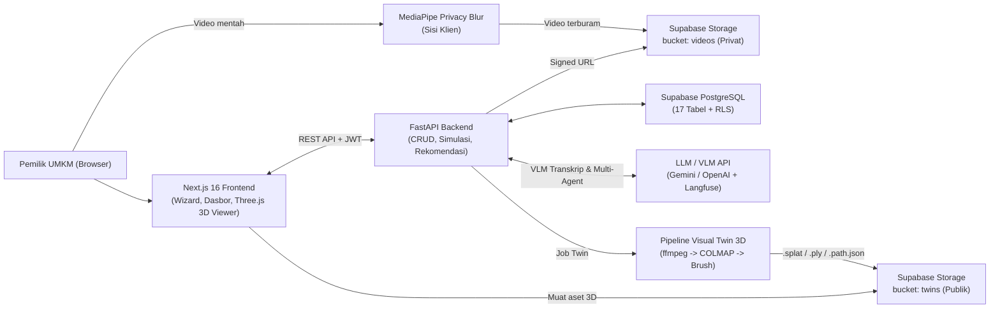

# Sekilas

> **Kategori:** Aplikasi Web (*Web Application*)
> **Nama Aplikasi:** Sekilas

Simulator calon pelanggan berbasis *Multi-Agent LLM* dan *Visual Twin 3D* untuk membantu UMKM kuliner memetakan titik gesekan (*friction points*) fisik toko dari satu rekaman video ponsel. Spesifikasi lengkap: [context/PRD.md](context/PRD.md) (v1.4) & [context/design.md](context/design.md).

---

## Tim Pengembang

- **Nama Tim:** *(Isi nama tim)*
- **Daftar Anggota:**
  - Muhammad Rizain Firdaus (`@inRiza`)
  - `@iammadsfq`
  - `@gitaa001`

---

## Latar Belakang, Masalah, Solusi & Target Pengguna

- **Masalah yang Diangkat:** Banyak UMKM kuliner kehilangan calon pelanggan sebelum transaksi terjadi akibat gesekan fisik di toko—seperti papan menu yang sulit terbaca dari luar, alur antrean yang membingungkan, area duduk yang terasa sempit, atau pencahayaan yang kurang mengundang. Riset UX ruang fisik secara manual memakan biaya dan waktu tinggi.
- **Deskripsi Solusi:** **Sekilas** mengubah satu rekaman video *walk-through* dari ponsel menjadi **Visual Twin 3D** dan **Simulasi Multi-Agent LLM**. Sistem memetakan perjalanan calon pelanggan dari depan toko hingga kasir, mengidentifikasi titik *drop-off* tertinggi, menyusun rekomendasi perbaikan berbasis prioritas Pareto, dan memproyeksikan dampak perbaikan sebelum pemilik melakukan perubahan fisik.
- **Target Pengguna:** Pemilik dan pengelola UMKM kuliner (kedai kopi, kafe, warung makan, restoran kasual, serta gerai F&B dengan satu atau banyak cabang).

---

## Fitur Utama yang Diimplementasikan

1. **Autentikasi & Manajemen Bisnis/Cabang (`/masuk`, `/daftar`, `/businesses`, `/businesses/analyses`)**
   - Registrasi dan login berbasis Supabase Auth dengan isolasi data per pengguna (*Row-Level Security*).
   - Manajemen banyak bisnis/cabang dan riwayat siklus analisis per cabang.
2. **Wizard Analisis 6 Langkah (`/business/analysis/...`)**
   - **Konteks & Menu (`/konteks`):** input profil usaha, jam ramai, target pelanggan, daftar menu & harga, serta kendala awal.
   - **Unggah & Inspeksi Video (`/video`):** validasi kualitas video di browser, *privacy blur* wajah otomatis di sisi klien sebelum unggah ke bucket privat `videos`, penandaan titik referensi (mis. kasir), dan sampling frame bukti.
   - **Pemrosesan Paralel AI & 3D (`/proses`):**
     - *Transkrip VLM*: mengekstrak segmen & checkpoint pengalaman pelanggan dari frame video.
     - *Visual Twin 3D*: membangun peta kamera dan ruang 3D (`.ply`, `.splat`, `camera_path.json`) beserta diagnosis kualitas pemetaan.
   - **Verifikasi Transkrip (`/verifikasi`):** pemilik meninjau dan mengoreksi hasil pembacaan AI sebelum simulasi dijalankan.
   - **Konfigurasi Persona & Agen (`/agents`):** membentuk populasi agen pelanggan virtual dengan beragam persona dan sensitivitas terhadap antrean, harga, kejelasan menu, serta suasana.
   - **Simulasi Multi-Agent (`/simulasi`):** simulasi perjalanan agen melewati tiap segmen toko untuk memetakan titik ragu dan *drop-off* (Mode 1: baseline).
3. **Dasbor Hasil, Rekomendasi & Penampil 3D (`/dasbor`, `/hasil`)**
   - **KPI & Funnel Drop-off:** ringkasan tingkat konversi, titik *drop-off* tertinggi, dan *key insights* penyebab utama.
   - **Peringkat Masalah & Rekomendasi Pareto:** prioritas aksi perbaikan berdampak tertinggi dengan usaha paling ringan (toggle *Prioritas / Nanti*) serta **Proyeksi Mode 2** untuk mensimulasikan dampak perbaikan.
   - **Video Waypoint & Replay Agen:** lompat langsung ke detik video bukti per checkpoint (melalui Signed URL) beserta narasi keputusan agen.
   - **Visual Twin 3D Interaktif:** penampil Gaussian Splat / Point Cloud di browser dengan navigasi jalur kamera dan penandaan zona toko.
   - **Rencana Pengukuran Lapangan:** target metrik evaluasi pasca-perbaikan di toko nyata.

---

## Teknologi yang Digunakan

| Lapisan | Teknologi / Library |
| :--- | :--- |
| **Frontend** | Next.js 16 (App Router), React 19, TypeScript, Tailwind CSS 4, `motion`, `lucide-react`, `@tabler/icons-react`, Vitest |
| **3D & Privasi Klien** | `three`, `@react-three/fiber`, `@react-three/drei`, `@mediapipe/tasks-vision` |
| **Backend API** | FastAPI, Uvicorn, Pydantic v2, SQLAlchemy 2.0, `psycopg`, `pgvector`, `httpx`, `arq` |
| **Statistik & Simulasi** | `numpy`, `statsmodels`, `SALib` |
| **AI & Observabilitas** | `google-genai` (Gemini VLM & LLM), `anthropic` / OpenAI-compatible client, `langfuse` |
| **Pipeline Visual Twin 3D** | `ffmpeg`, COLMAP (SfM / *sparse point cloud*), Brush v0.3.0 (Gaussian Splatting) |
| **Database, Auth & Storage** | Supabase (PostgreSQL 17 tabel + RLS, Supabase Auth, Storage bucket `videos` privat & `twins` publik), Redis (opsional lokal) |

---

## Diagram Arsitektur Sistem & Alur Data



**Ringkasan Alur Data:**
1. Video walk-through diburamkan wajahnya di browser (`@mediapipe/tasks-vision`) lalu diunggah ke bucket privat `videos`.
2. Backend mengakses video/frame melalui Signed URL (`SUPABASE_SECRET_KEY`) untuk dua job paralel: **Transkrip VLM** (Gemini) dan **Visual Twin 3D** (`ffmpeg` → COLMAP → Brush → bucket publik `twins`).
3. Hasil transkrip yang telah diverifikasi pemilik dipakai oleh mesin **Simulasi Multi-Agent** untuk menghasilkan metrik *drop-off*, rekomendasi Pareto, dan proyeksi Mode 2 di dasbor.

---

## Dokumentasi Penggunaan AI

1. **Ekstraksi Transkrip Video (VLM):** menggunakan model multimodal Gemini (`gemini-3.8-flash` dengan fallback `gemini-3.6-flash`, `gemini-3.5-flash`) untuk membaca frame video dan mengidentifikasi segmen perjalanan pelanggan, timestamp checkpoint, serta isu visual fisik toko.
2. **Simulasi Multi-Agent LLM:** memodelkan populasi agen virtual (default `500` agen dengan seed deterministik, atau `LLM_MODE=mock` untuk pengujian tanpa panggilan API eksternal) yang mengevaluasi tiap segmen toko dan menghasilkan alasan *drop-off* serta proyeksi dampak perbaikan (Mode 2).
3. **Deteksi Wajah / Privacy Blur (Edge AI di Browser):** menggunakan `@mediapipe/tasks-vision` untuk menyamarkan wajah pengunjung/staf secara lokal sebelum file meninggalkan perangkat pengguna.
4. **Observabilitas LLM:** terintegrasi dengan **Langfuse** (`LANGFUSE_PUBLIC_KEY`, `LANGFUSE_SECRET_KEY`) untuk melacak prompt, token, dan latensi.

---

## Struktur Repositori

```text
fe/          Next.js 16 (App Router): Landing page, Manajemen Bisnis/Cabang, Wizard Analisis, Dasbor & Penampil 3D
be/          FastAPI + SQLAlchemy 2.0: CRUD Bisnis/Analisis/Konteks, Transkrip VLM, Simulasi Agen, Rekomendasi & Dasbor
twin/        Pipeline Visual Twin 3D: Video -> Frame -> COLMAP -> .ply / .path.json / Brush Gaussian Splat (.splat)
supabase/    Migrasi SQL (`migrations/`) & data awal (`seed.sql`) yang terhubung ke proyek Supabase
scripts/     Skrip bantu lokal (`dev-e2e.sh`)
context/     PRD v1.4 & Panduan Sistem Desain (Editorial Warmth)
```

---

## Panduan Instalasi, Konfigurasi & Menjalankan Aplikasi

### 1. Daftar Variabel Lingkungan

#### Backend ([`be/.env.example`](be/.env.example))
| Variabel | Fungsi |
| :--- | :--- |
| `APP_ENV`, `API_PREFIX`, `CORS_ORIGINS` | Konfigurasi aplikasi, prefix `/api/v1`, dan origin frontend (`["http://localhost:3000"]`) |
| `DATABASE_URL` | Koneksi PostgreSQL (Supabase Postgres atau Docker lokal) |
| `SUPABASE_URL`, `SUPABASE_PUBLISHABLE_KEY`, `SUPABASE_SECRET_KEY` | Koneksi Supabase Auth & Storage (`SUPABASE_SECRET_KEY` wajib untuk Signed URL bucket privat `videos`) |
| `MEDIA_SIGNING_SECRET`, `SIGNED_URL_TTL_SECONDS` | Konfigurasi penandatanganan & masa berlaku Signed URL (default `3600` detik) |
| `REDIS_URL`, `STORAGE_DIR` | Koneksi Redis (opsional lokal) & direktori penyimpanan lokal `./storage` |
| `GEMINI_API_KEY`, `GEMINI_MODEL`, `GEMINI_FALLBACK_MODELS` | Kunci API & model Gemini untuk VLM transkrip dan simulasi agen |
| `OPENAI_API_KEY`, `OPENAI_MODEL` | Alternatif / konfigurasi model OpenAI |
| `SIM_DEFAULT_AGENTS`, `SIM_DEFAULT_SEED`, `SIM_BATCH_SIZE`, `SIM_CONCURRENCY_LIMIT` | Parameter simulasi multi-agen (default `500` agen, seed `42`) |
| `MAX_VIDEO_DURATION_SECONDS`, `MAX_VIDEO_SIZE_MB` | Batas unggahan video (`180` detik, `100` MB) |
| `TWIN_QUEUE_NAME`, `TWIN_LOCAL_RUNNER`, `TWIN_MAX_FRAMES`, `TWIN_DEVICE` | Pengaturan pipeline Visual Twin (`TWIN_LOCAL_RUNNER=true` untuk menjalankan skrip lokal dari API) |
| `LANGFUSE_PUBLIC_KEY`, `LANGFUSE_SECRET_KEY`, `LANGFUSE_HOST` | Opsional pelacakan observabilitas LLM di Langfuse |

#### Frontend ([`fe/.env.example`](fe/.env.example))
| Variabel | Fungsi |
| :--- | :--- |
| `NEXT_PUBLIC_SUPABASE_URL` | URL proyek Supabase |
| `NEXT_PUBLIC_SUPABASE_PUBLISHABLE_KEY` | Publishable key Supabase untuk autentikasi klien |
| `NEXT_PUBLIC_API_URL` | URL backend FastAPI (default `http://localhost:8000`) |

### 2. Menjalankan Backend (`be/`)
```bash
# Opsional bila memakai DB & Redis lokal:
docker compose up -d db redis

cd be
cp .env.example .env
# Lengkapi DATABASE_URL, SUPABASE_SECRET_KEY, dan GEMINI_API_KEY / OPENAI_API_KEY di .env
uv sync
uv run uvicorn app.main:app --reload        # API & Swagger UI: http://localhost:8000/docs
```

Pengujian dan linter backend:
```bash
cd be
uv run ruff check .
LLM_MODE=mock uv run pytest
```

### 3. Menjalankan Frontend (`fe/`)
```bash
cd fe
cp .env.example .env.local
bun install                                 # atau: npm install
bun dev                                     # Aplikasi web: http://localhost:3000
```

Pengujian, pemeriksaan tipe, dan linter frontend:
```bash
cd fe
npm test && npx tsc --noEmit && npm run lint
```

### 4. Konfigurasi Tambahan Fitur Visual Twin 3D (`twin/`)
Dengan `TWIN_LOCAL_RUNNER=true` di `be/.env`, rekonstruksi 3D dijalankan otomatis dari backend via [`twin/scripts/local_twin.sh`](twin/scripts/local_twin.sh) dan membutuhkan `colmap`, `ffmpeg`, `brush_app` (di `twin/.tools/brush_app`), serta environment Python `twin/`:

- **macOS (Apple Silicon):**
  ```bash
  brew install ffmpeg
  ./twin/scripts/setup_local.sh
  ```
- **Linux (`x86_64`):** pastikan `colmap` dan `ffmpeg` tersedia di `PATH` (mis. via `apt` atau `micromamba` dari `conda-forge`), letakkan binary Linux `brush_app` (`v0.3.0`) di `twin/.tools/brush_app`, lalu jalankan:
  ```bash
  cd twin && uv sync
  ```

Lihat panduan lengkap dan opsi worker GPU di [twin/README.md](twin/README.md).

---

## Akun Demonstrasi

Aplikasi menggunakan **Supabase Auth** untuk autentikasi pengguna. Untuk pengujian cepat, silakan masuk melalui `/masuk` menggunakan akun demonstrasi berikut:

- **Email:** `icon.firdaus@gmail.com`
- **Password:** `icanmainsekilas`

Pengguna juga dapat membuat akun baru langsung melalui `/daftar`. Data sampel bawaan (*Selasar Kopi*, `selasar-kopi`) tersedia di [`supabase/seed.sql`](supabase/seed.sql).

---

## Atribusi Template, Aset, Dataset & Kode Pihak Ketiga

- **COLMAP** (BSD License) — *Structure-from-Motion* dan rekonstruksi *sparse point cloud* ([colmap/colmap](https://github.com/colmap/colmap)).
- **Brush** v0.3.0 (Apache-2.0 License) — Gaussian Splatting oleh Arthur Brussee ([ArthurBrussee/brush](https://github.com/ArthurBrussee/brush)).
- **FFmpeg** (LGPL/GPL) — ekstraksi frame video.
- **MediaPipe Tasks Vision** (`@mediapipe/tasks-vision`, Apache-2.0 License) — deteksi wajah untuk *privacy blur* di browser.
- **Three.js**, **React Three Fiber**, dan **Drei** (MIT License) — rendering interaktif Visual Twin 3D di web.
- **Next.js**, **React**, **Tailwind CSS**, **FastAPI**, **SQLAlchemy**, **Supabase JS/SSR**, **Lucide Icons**, **Tabler Icons**, dan **Motion** — digunakan sesuai lisensi open-source masing-masing.
